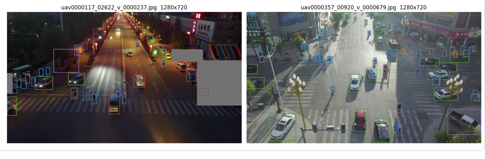
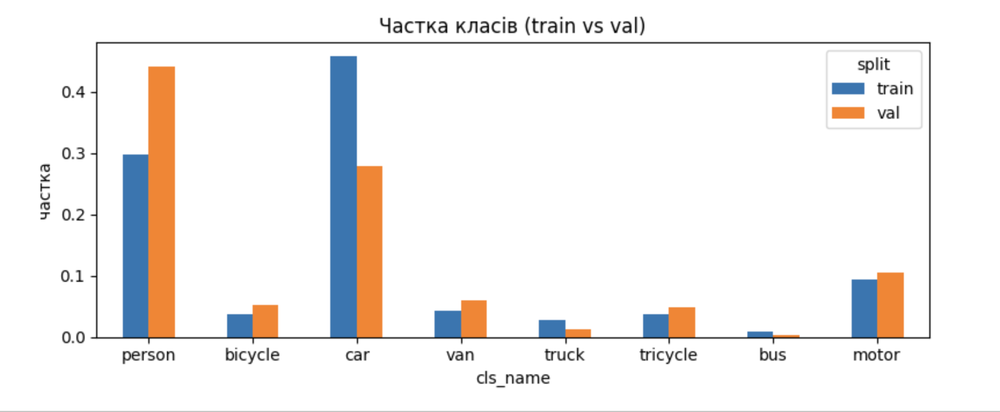

## 1. Methodology and motivation

**1.1. Data preparation**

Спочатку я переглянув, з чого складається датасет: train сет на 56 кліпів, val сет з 7 кліпів, всього це 27047 кадрів, 1,219,648 об'єктів у 8 класах: person, truck, bicycle, tricycle, car, bus, van, motor, а також 48 test-кліпів на 3 811 кадрів. Кілька висновків, які я зробив в результаті аналізу:

- Дисбаланс класів. Car складає приблизно 46% об'єктів в train set, person приблизно 30%, а bus менше 1%. Тому AP по bus і truck (<3%) буде дуже шумним, і я не спирався на нього при порівнянні моделей.
- Також є велика різниця між train і val set в розподілі класів: якщо брати до уваги val сет, то там більше класу person (44%), аніж car (28%). Саме тому я вирішив обʼєднати ці два датасети в один пул (63 кліпи) і перерозподілити їх на 5 фолдів та обрати той один holdout fold, який найбільш наближений в розподілі класів до загального.
- Об'єкти дрібні. Медіанний бокс 44×49 px. Якщо стиснути кадр до 960 px по довгій стороні, то 73% об'єктів стануть меншими за 32 px, а при 1280 px таких обʼєктів лишається 54%. Саме тому я перевіряв потім різні розміри кліпів, які йдуть на вхід до моделі: як 1280, так і 960 px.
- В середньому 45 об'єктів на кадр, максимум 180.
- Роздільність train і test різна. У train/val кадри від 1344×756 до 3840×2160, а в test від 680×382 до 1920×1080. Саме цей факт найбільше впливав на все тестування, адже той score, який я отримував на holdout фолдах, часто відрізнявся від public score на leaderboard.

Ignored regions є у 75% кадрів train і 50% val. Це не рідкісний випадок, тож їх правильна обробка важлива. Забігаючи наперед, скажу, що Ultralytics не вміє їх маскувати, тому в train кадрах я ignored regions замальовував сірим кольором для того, щоб модель не вчилася з них і не вважала вміст ignored regions фоном. А в оцінці ці сірі зони йдуть як `iscrowd=1`, тобто детекції в них не штрафуються.

Проаналізувавши датасет, я помітив також, що сусідні кадри відео майже однакові, тож я брав кожен 4-й кадр. Пізніше я тренував найкращу модель на step=2 і на основі отриманих значень метрик зробив висновок, що збільшення кількості аналізованих кадрів не покращує модель.

**1.2. Validation design**

Як я вже казав, train і val мають різний розподіл класів, що видно на графіку (особливо person та car), крім того, кадри одного відео дуже схожі між собою, тому випадковий спліт за кадрами дав би витік інформації. Саме тому я об'єднав train і val в один пул із 63 кліпів і розбив його на 5 фолдів за кліпами (GroupKFold).

Повний 5-fold CV для чотирьох сімейств моделей (в кожній з яких як мінімум три експерименти) я не міг собі дозволити, враховуючи обмеженість GPU. Тому всі порівняння я робив на одному holdout-фолді (fold 4: 12 кліпів, 1 169 кадрів). Я обрав саме його, бо розподіл класів у ньому найближчий до загального, і в ньому достатньо рідкісних класів. Вочевидь, один фолд дає шумні оцінки. Тому різницю mAP менше за 0.02 я вважав шумом.

Для оцінки я написав одну функцію, щоб такі метрики як mAP, AP50 і AP за розмірами для всіх моделей рахувалися однаково.

**1.3. Models**

Тренував і тестував я чотири різні сімейства моделей:

- Faster R-CNN (two-stage),
- RetinaNet (one-stage anchor-based),
- YOLO11 (anchor-free),
- та RT-DETR (query-based).

Для кожного сімейства я робив baseline і принаймні два експерименти, один із яких міняв params, інший loss.

**1.4. Tuning strategy**

Знову ж таки, обчислювальні ресурси були обмежені (я використовував Google Colab T4), тому на кожне тренування виходило 3-4 епохи (для YOLO я міг застосувати 12 епох). Щоб не витрачати багато відправок на Kaggle, у деяких експериментах я змінював кілька параметрів одразу, через що внесок окремої зміни складно виокремити, але загалом мені було важливіше перевірити, який ефект дасть зміна гіперпараметрів. Якщо перший експеримент не давав значущого приросту, наступний я робив поверх baseline, а не поверх попереднього (в плані того, які параметри я використовував для моделі).

**1.5. Reasons for the main choices**

Схоже я вже казав в минулій домашній, і тут те саме: інтуїція часто підводить. Наприклад, anchors з k-means звучали ідеальним рішенням “на папері”, але в реальності я не отримав бажаного покращення (навпаки, модель погіршилася, показавши score 0.025 замість score базової моделі 0.098).

## 2. Results and analysis

**2.1. Consistent benchmarks**

Всі моделі я порівнював на тому самому holdout за однаковою оцінкою. Також для кожного сімейства був свій baseline (модель з незатюненими гіперпараметрами). І, звісно, найосновніший бейзлайн, який вказував на те, чи взагалі не марні мої старання та моделі - той baseline, що в leaderboard (public 0.2216, private 0.2023). На моє здивування, більшість випробуваних моделей навіть зі зміною гіперпараметрів показували гірший результат, ніж цей бейзлайн.

| Модель | mAP (holdout) | AP50 | APs | мс/кадр | Public | Private |
|---|---|---|---|---|---|---|
| Baseline змагання | – | – | – | – | 0.2216 | 0.2023 |
| Faster R-CNN base | 0.184 | 0.359 | 0.038 | 62 | 0.1838 | 0.1568 |
| Faster R-CNN + RPN 3000/2000, RoI 0.5 | 0.184 | 0.361 | 0.038 | 73 | 0.1861 | 0.1550 |
| Faster R-CNN + GIoU loss | 0.183 | 0.357 | 0.040 | 72 | 0.1902 | 0.1577 |
| RetinaNet base | 0.072 | 0.147 | 0.006 | 65 | 0.0988 | 0.0756 |
| RetinaNet + anchors з k-means | 0.027 | 0.090 | 0.013 | 54 | 0.0255 | 0.0214 |
| RetinaNet + anchors ×0.5, IoU, GIoU, focal | 0.082 | 0.182 | 0.016 | 55 | 0.1039 | 0.0836 |
| YOLO11s base, 12 ep | 0.198 | 0.368 | 0.045 | 22 | 0.2330 | 0.1783 |
| YOLO11s exp1 (box/dfl↑, scale↓), 12 ep | 0.188 | 0.355 | 0.050 | 19 | не відправляв | – |
| YOLO11s base, 4 ep | 0.202 | 0.384 | 0.046 | 20 | 0.2671 | 0.1841 |
| YOLO11s exp1, 4 ep | 0.197 | 0.371 | 0.048 | 21 | не відправляв | – |
| YOLO11s 1280 + P2-голова | 0.188 | 0.374 | 0.060 | 35 | не відправляв | – |
| YOLO11s 1280 | 0.213 | 0.400 | 0.070 | 25 | 0.2058 | 0.2133 |
| RT-DETR-L base | 0.088 | 0.157 | 0.020 | 57 | 0.0719 | 0.0794 |
| RT-DETR + 500 queries, 200 denoising | 0.068 | 0.120 | 0.016 | 58 | 0.0624 | 0.0782 |
| RT-DETR + вага GIoU ×2 | 0.064 | 0.114 | 0.016 | 57 | 0.0494 | 0.0504 |
| YOLO11s 4 ep + flip (960) | – | – | – | – | 0.2758 | 0.2049 |
| YOLO11s 4 ep + мультискейл 800 і 960 + flip | – | – | – | – | 0.2892 | 0.2124 |
| YOLO11s 4 ep + мультискейл 640, 800, 960 + flip | – | – | – | – | 0.2900 | 0.2114 |
| Ансамбль із 3 моделей (1280, 960, P2) | 0.246 | – | 0.077 | 93 | 0.2572 | 0.2285 |
| Ансамбль із 3 моделей + flip | – | – | – | – | 0.2856 | 0.2404 |
| YOLO11m, мультискейл 800 і 960 + flip | – | – | – | – | 0.2234 | 0.2296 |
| Мультискейл 960 + ансамбль + YOLO11m | – | – | – | – | 0.2875 | 0.2528 |
| Ансамбль на 63 кліпах | – | – | – | – | 0.2244 | 0.2329 |
| Ансамбль на 63 кліпах + flip | – | – | – | – | 0.2347 | 0.2456 |
| Ансамбль на 63 кліпах, step=2 | – | – | – | – | 0.2230 | 0.2266 |
| Data Temporality (`temporal_smooth`, rescore α=1) | 0.241 | – | 0.075 | – | 0.3043 | 0.2303 |
| `test_ms_plus_pipe_h_flip` (обраний) | 0.258 | – | 0.084 | – | 0.3088 | 0.2404 |
| `cached_best_search` | 0.258 | – | 0.084 | – | 0.3088 | 0.2404 |
| `cached_smooth_search` (обраний) | 0.257 | – | 0.083 | – | 0.3099 | 0.2395 |

**2.2. Improvements**

Процес покращення був ітеративним, і не всі кроки давали приріст (ось тут часто помилялася інтуїція, бо неодноразово мої наступні експерименти виявлялися гіршими на public за попередні). Почну з того, що з Faster R-CNN я приросту не отримав взагалі: і збільшення кількості пропозалів RPN, і заміна loss на GIoU змінили holdout mAP менш ніж на 0.002 (public scores були 0.1838, 0.1861 і 0.1902 відповідно). Причину я знайшов: приблизно 27% дрібних об'єктів RPN не пропонує взагалі, тобто модель пропустила 63% small, 30% medium і лише 13% large об'єктів.

Далі з RetinaNet історія цікавіша. Спроба використати k-means anchors провалилась, зате комбінований експеримент (anchors вдвічі менші, нижчі пороги IoU, GIoU і focal loss з іншими параметрами) підняв mAP з 0.072 до 0.082 (score з 0.098 до 0.104). Але цей варіант лишився вдвічі слабшим за Faster R-CNN.

Справжнє покращення почалось з anchor-free YOLO11. Базова модель на 12 епох відразу дала 0.233 на public, тобто вперше перегнала baseline змагання. Далі я помітив, що mAP на holdout виходить на плато вже після 1-2 епох, тому спробував скоротити тренування до 4 епох. На public стрибок був помітний: з 0.233 до 0.267. Далі цікавий інсайт: збільшення входу до 1280 px дало приріст на holdout (mAP 0.213, APs 0.046 -> 0.070), але на public ця модель показала лише 0.2058, тобто гірше за 960 px, що означає, що для тесту краще брати нижчий вхід.

Найбільший приріст я отримав не від нових тренувань, а від інференсу. Flip, multiscale і ensemble піднімали public крок за кроком: модель `yolo11s_base_4ep` 0.2671 -> з фліпом 0.2758 -> мультискейл 800 і 960 0.2892 -> ансамбль з 1280-моделлю та моделлю з P2-головою 0.3088 → smoothed ваги 0.3099. Тобто без жодного нового тренування score виріс приблизно на 0.04. На holdout-фолді ансамбль із трьох моделей теж був найкращим (mAP 0.246 проти 0.211 для однієї моделі на 1280).

**2.3. Feature experiments, unsuccessful attempts**

Дещо я вже проговорив, тут окремі деталі:

- K-means anchors. Мені здавалось, що anchors, виведені зі статистики боксів, мають бути ідеальними. Насправді для об'єктів більших за 48 px покриття було лише 23%, і public впав до 0.0255.
- Додаткова P2-голова з кроком 4 px стартувала з випадкових ваг і за 4 епохи не встигла зійтись.
- RT-DETR теж не зійшовся за кілька епох, а експерименти з більшою кількістю queries та вагою GIoU ще й погіршили результат (public 0.0624 і 0.0494 проти 0.0719).
- Більша модель YOLO11m на holdout була найкращою з усіх (mAP50-95 0.241 проти 0.215), але на public її одиночна версія дала лише 0.2234 проти 0.2892 в YOLO11s, а в ансамблі знизила score з 0.3088 до 0.2875. Цікаво, що на private все навпаки: ансамбль із YOLO11m показав 0.2528, тобто краще за обидва обрані мною файли (0.2395 і 0.2404). Тож все таки варто було обрати цю модель фінально, а не YOLO11s.
- Моделі на всіх 63 кліпах (без holdout-валідації). Логічно, що я очікував, що з більшою кількістю даних модель стане кращою. Але public ансамблю на 63 кліпах (0.2244) виявився гіршим за ансамбль на 51 кліпі (0.2572), а варіант зі step=2 (кожні два кадри замість чотирьох) теж не покращив score.
- Також я спробував бонусний Data Temporality (рескоринг детекцій за сусідніми кадрами). На holdout усі варіанти погіршили mAP (0.257 → 0.216-0.241), і на public я отримав не кращий результат.

**2.4. Conclusions supported by results**

- Найкращим виявився anchor-free YOLO. Anchor-based детектори більше залежать від того, наскільки anchors відповідають розмірам об'єктів.
- Найбільший внесок у фінальний результат дав інференс: фліп, мультискейл та ансамбль підняли public з 0.267 до 0.310 без нового тренування.
- Найважливіший висновок про validation: holdout правильно передбачив порядок сімейств моделей, але не дрібні відмінності між моделями. Яскравий приклад YOLO на 1280, яка була кращою на holdout, але гіршою на public. Причина: test-кадри менші, ніж train, тому великі входи там не допомагають, і це підтверджується тим, що на test допомагали саме менші масштаби інференсу.

## 3. Final model and run instructions

**3.1. Selected model**

Фінальне рішення - це ансамбль із трьох моделей YOLO11s, кожна з яких тренувалась 4 епохи на 51 кліпі (fold 0-3):

- `yolo11s_base_4ep` з входом 960,
- `yolo11s_exp2a_1280_only` з входом 1280,
- `yolo11s_exp2_1280_p2` (YOLO11s з P2-головою) з входом 1280.

Кожен вид іде зі звичайним і дзеркальним проходом (flip), результат зливається через WBF (`iou=0.6`, `skip=0.005`), максимум 500 боксів на кадр. Для leaderboard я обрав два файли з цього ансамблю:

- `cached_smooth_search`: масштаби 640 (вага 0.5), 800 і 960 для моделі 960 + обидві моделі 1280. Public 0.3099, private 0.2395.
- `test_ms_plus_pipe_h_flip`: та сама схема, але без масштабу 640. Public 0.3088, private 0.2404.

**3.2. Dependencies and settings**

Потрібні бібліотеки: `ultralytics`, `ensemble-boxes`, `pycocotools`, `torch`, `torchvision`, `scikit-learn`, `opencv-python`, `pandas`. Я працював у Google Colab на Tesla T4. Для всіх YOLO: `epochs=4`, `warmup_epochs=1`, `close_mosaic=1`, `seed=0`, для моделей з входом 1280 `batch=8`.

**3.3. How to run**

Достатньо відкрити ноутбук і запустити клітинки по черзі.

Найважливіші клітинки - це розпакування даних (в мене архів з даними зберігався на Google Drive, також там же у мене лежали результати тренування моделей, submission-файли тощо, ось посилання на папку з усіма результатами https://drive.google.com/drive/folders/1UvWaWm8ZL_CvGr9szzmD-XSSY7bKv_nk?usp=sharing), фолди (зберіг у `folds.csv`, щоб були незмінними) і конвертація кадрів у 1280 px, а також спільні функції (наприклад, `attach_progress`, `evaluate`). Щоб запустити саме фінальну модель, необхідне тренування трьох моделей: `yolo11s_base_4ep` (`imgsz=960`), `yolo11s_exp2a_1280_only` (`imgsz=1280`) та `yolo11s_exp2_1280_p2` (власний yaml з P2, `imgsz=1280`). Час тренування трьох моделей я не міряв бібліотеками, але це приблизно 15 + 26 + 43 хв, а кешування й злиття ще 1-2 години.